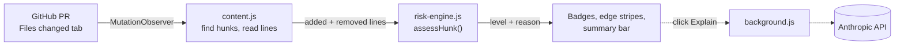
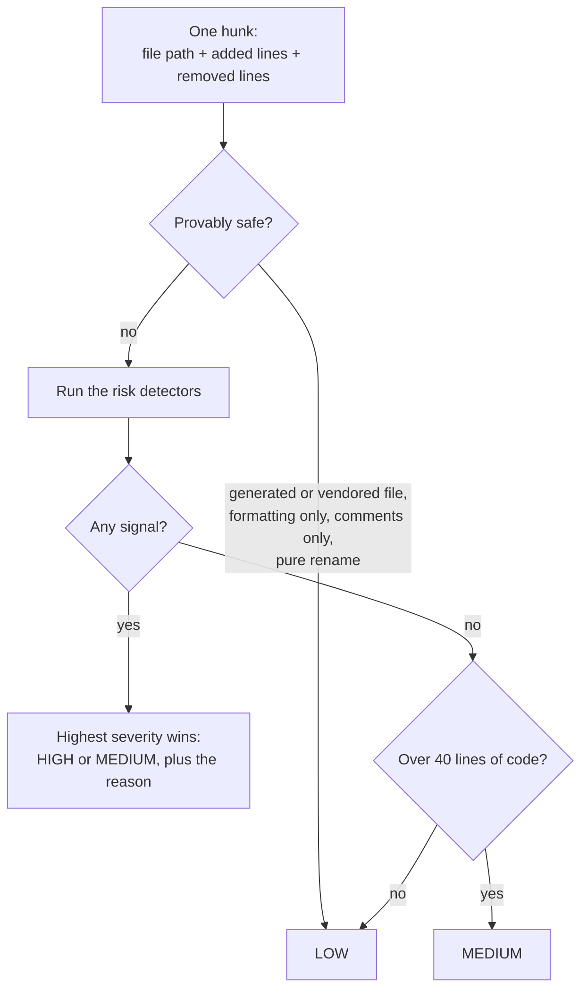

# Diff Risk Highlighter

A Chrome extension that reads a GitHub pull request's **Files changed** tab and tells you which hunks deserve careful review and which are safe to skim. It uses plain static heuristics, so it runs instantly, offline, and with no API key.

<picture>
  <source media="(prefers-color-scheme: dark)" srcset="docs/img/screenshot-dark.png">
  
</picture>

<sub>Rendered by headless Chrome from [a fixture page](test/dom/pull/999/changes/new-ui-fixture.html) that copies GitHub's current diff markup, running the real `content.js`. Follows GitHub's light/dark theme.</sub>

## What it does

- **Flags risky hunks** with a colored edge and a `HIGH` / `MEDIUM` badge. Hover a badge to see *why*.
- **Leaves safe hunks alone.** Reformatting, renames, comments, docs, generated and vendored files are scored low and left untouched.
- **Summarizes the PR** in a sticky bar: counts, a proportional risk meter, and one-click jumps to every high-risk hunk.
- **Optional "Explain" button** on high-risk hunks asks Claude for a one-sentence explanation. Nothing leaves your browser unless you click it.

## How it works



`risk-engine.js` knows nothing about the DOM. It takes one hunk and returns `{ level, reason }`, which is why it is unit-testable in plain Node. `content.js` handles everything GitHub-specific, for both GitHub's classic diff markup and its newer React layout (`/changes`).

### The risk engine



Safe-transform checks run **first**, so renaming a variable called `password` is still low risk. Formatting-only includes whitespace, trailing commas, and quote style (but not when the line interpolates, since `"$x"` and `'$x'` differ in shell).

| Signal | Level | Notes |
|---|---|---|
| SQL built by string concatenation | High | verb + clause + concatenation within a few lines |
| Off-by-one shape: operator swap (`..` to `..=`), literal shifted by 1, or a `± 1` term added or removed from a bound/index expression | High | version-shaped numbers are ignored |
| `try`/`catch`/`except` count decreased | High | a re-indented try/catch doesn't count |
| Removed synchronization (lock, mutex, atomic, `synchronized`) | High | swapping one primitive for another nets out |
| Security keywords (`password`, `jwt`, `csrf`, `authorization`, ...) in source code | High | matches inside `verify_password` / `checkPassword`; **Medium** inside test files |
| Added locking or atomicity | Medium | most race fixes add synchronization |
| New check-then-act on a shared container, in concurrent code, with no lock | Medium | deliberately narrow |
| Weakened or removed test assertion, or a newly skipped test | Medium | test files only |
| Conditional branch removed | Medium | High if it also drops a `return`/`raise`, or 3+ branches |
| Function signature changed | Medium | catches a single added default value |
| Large hunk with no other signal | Medium | fallback |

Documentation files (`*.md`, `CHANGELOG`, `docs/`, ...) skip the security-keyword and boundary detectors and the large-hunk fallback, since prose that *describes* an authorization fix isn't one.

## Install

No build step and no runtime dependencies.

1. Open `chrome://extensions` and turn on **Developer mode**.
2. Click **Load unpacked** and choose this folder.
3. Open any pull request's **Files changed** tab.

The toolbar icon toggles highlighting on and off (an `OFF` badge shows when it's disabled). The first time you click **Explain**, it asks for an Anthropic API key, which is stored only in `chrome.storage.local` and sent only to `api.anthropic.com`.

## Develop

```bash
npm test          # unit, real-PR and fixture-metadata tests (Node's built-in runner, no install needed)
npm run icons     # regenerate icons/ (dependency-free PNG encoder)
python3 -m http.server 8934
```

With the server running, open these pages. Each runs the **real** `src/` files and prints PASS or FAIL:

| Page | Checks |
|---|---|
| `/test/dom/pull/999/changes/new-ui-fixture.html` | 22 checks against GitHub's React markup: classification, summary bar, Explain, toggle, remount and tab-switch recovery, no self-triggering loop. Add `?theme=dark` for dark mode. |
| `/test/dom/pull/999/files/self-trigger-regression.html` | Classic markup, plus the mutation-observer loop guard |
| `/test/perf/synthetic-large-diff.html` | 150 files / 450 hunks scan timing |

### End-to-end tests (Playwright)

The e2e suite loads this folder as a real unpacked extension in Chromium and runs it on the live "Files changed" page of every PR behind `test/fixtures/real-prs/`, checking that the summary bar and badges match what the engine gives for each fixture. It needs network access to github.com, so it is separate from `npm test`.

```bash
npm install
npx playwright install chromium
npm run test:e2e
```

Signed out, GitHub serves the **classic** UI; the React UI is only served to signed-in sessions. To run against it, sign in once in the window this opens (you type your own credentials; cookies are saved to the gitignored `e2e/.auth/`):

```bash
npm run test:e2e:login
```

## How well do the heuristics work?

They are calibrated and regression-tested on **42 real merged PRs** from open-source repos (no toy examples), described in [test/fixtures/real-prs](test/fixtures/real-prs/README.md). [`metadata.json`](test/fixtures/real-prs/metadata.json) records which hunk is the actual fix in each PR, which makes this measurable. [`test/fix-recall.test.js`](test/fix-recall.test.js) is a ratchet on it:

| | Fix hunks flagged | Non-fix hunks flagged **high** |
|---|---|---|
| Before this change | 55 / 84 | 12 |
| Now | **68 / 84** | **6** |

What moved the numbers, each found by reading real output hunk by hunk:

- **Identifiers.** `\bpassword\b` never matched `verify_password` or `checkPassword`, because `_` counts as a word character. Missing-authorization and IDOR fixes were invisible. Now matched, in snake_case and camelCase.
- **Race fixes add locks.** Most fixes *add* synchronization, which the engine ignored. Now medium (adding a lock is usually right, but it changes what can interleave).
- **Test files.** A security word in a test is a medium nudge, not a red flag. This took passkey-kit#4 (an auth-bypass fix) from 5 high-noise hunks to 0 while keeping its 3 real fix hunks.
- **Quote style.** Prettier's `"x"` to `'x'` is formatting, unless the line interpolates.

Earlier review passes, also on real PRs: `± 1` off-by-one fixes (mglet-base#226), CHANGELOG prose and version bumps burying a real fix (passkey-kit#4), and keyword lists that were too broad (`admin`, `token`, `auth*` flagged all of `django.contrib.admin`).

## Known Limitations / Future Work

- **Heuristics, not parsing.** Regex and text matching can be fooled by a keyword in a string or comment. Swapping in a real AST (e.g. tree-sitter) is the natural v2.
- **16 of 84 real-fix hunks are still missed.** Examples: a lookup moved *inside* an existing lock (nats-server#8647), a CSRF cookie-prefix rename, and some thread-pool races in C. Check-then-act is only caught in code that visibly runs concurrently.
- **Narrow keyword lists on purpose.** Broader ones (`admin`, `token`, `auth*`) produced absurd false positives on real PRs. The cost is missing variants like `pwd`.
- **Added locking is a medium nudge, not proof of a fix.** It fires on any hunk that adds a lock, including ordinary new concurrent code.
- **GitHub changes its DOM.** It did mid-project: `/files` became `/changes` with a React rewrite. Both layouts are supported, with selectors documented in [docs/github-diff-dom.md](docs/github-diff-dom.md), but expect to re-check them occasionally.
- **Not yet verified:** the React UI against the e2e suite (signed out, GitHub serves the classic UI, which is what has been run: 68/68 passing), so its lazy-loading on very large PRs is untested. Run `npm run test:e2e:login` once, then `npm run test:e2e`. "Explain" has also only been tested with a mocked reply, not the live API.
- github.com only (no Enterprise domains). The sticky bar can overlap GitHub's own sticky headers slightly while scrolling.

## Project layout

```
manifest.json            Manifest V3 config
src/risk-engine.js       The heuristics: pure, DOM-free, unit-tested
src/content.js           Finds hunks (classic + React DOM), draws badges and the summary bar
src/background.js        Optional Anthropic call (CSP-safe) + toolbar toggle
icons/                   Generated by scripts/make-icons.js
docs/                    github-diff-dom.md (selector notes), img/ (screenshots)
test/                    Unit tests, 42 real-PR fixtures + metadata, DOM fixture pages, perf harness
e2e/                     Playwright: the real extension on live GitHub PRs
scripts/                 fetch-fixtures.js (collector), make-icons.js
```
