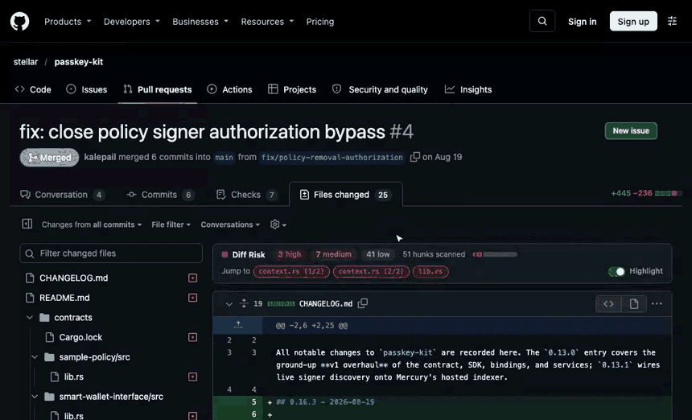
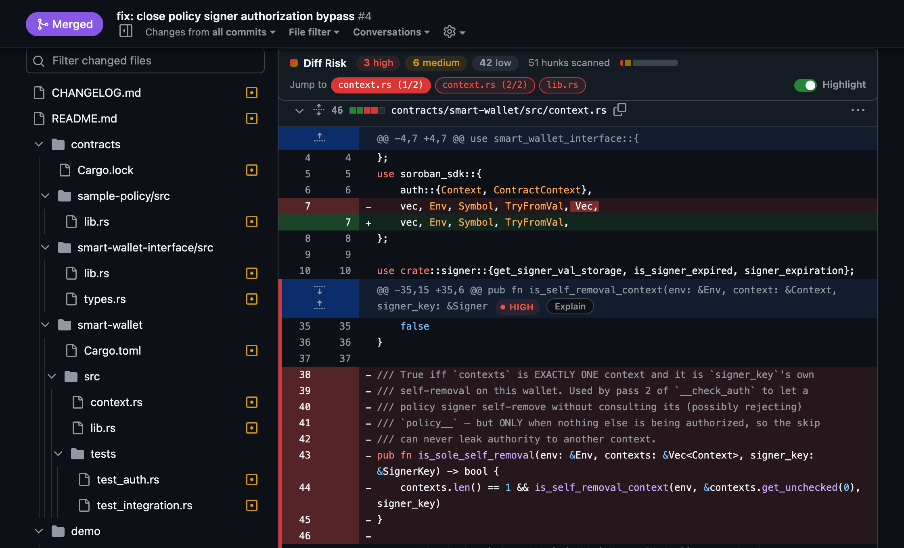
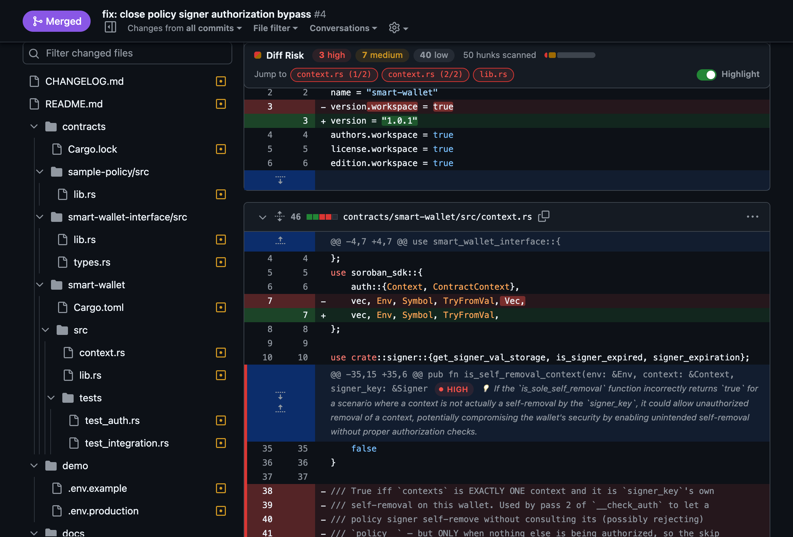
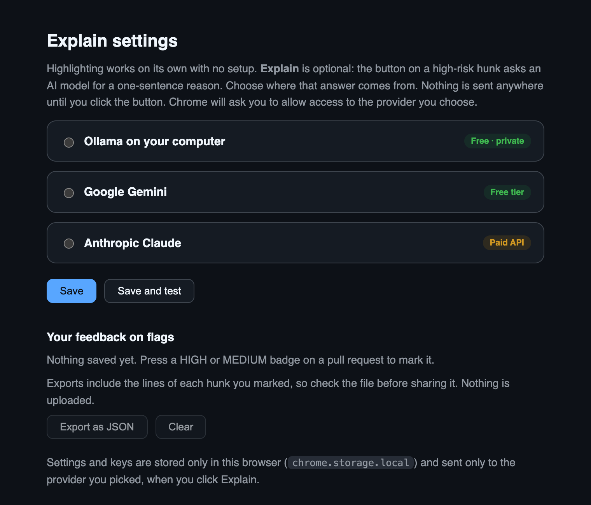
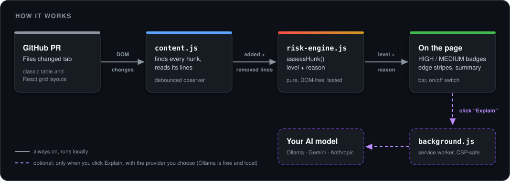
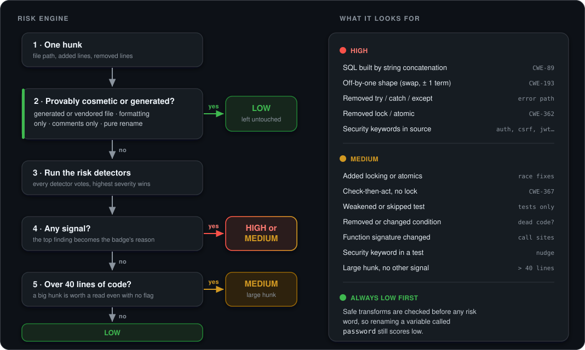
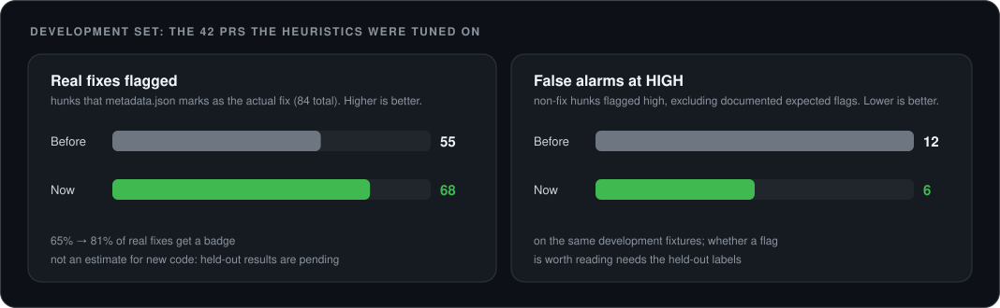

<div align="center">

# Diff Risk Highlighter

**See which hunks of a pull request to review first, and why.**

A Chrome extension that reads GitHub's **Files changed** tab and flags risky hunks with plain static heuristics. It runs instantly, offline, with no API key.

<br>



<sub>The real extension, loaded unpacked in Chromium, on a live pull request ([stellar/passkey-kit#4](https://github.com/stellar/passkey-kit/pull/4), an authorization-bypass fix) in GitHub's dark theme. Cursor and captions are added by [the recording script](scripts/record-demo.js). <a href="docs/img/demo.webm">Higher-quality WebM</a>.</sub>

</div>

<br>

**Install:** clone this repo, open `chrome://extensions`, turn on Developer mode, **Load unpacked** ([details](#install)).

## Evidence so far

| Question | Result | Measured on |
|---|---|---|
| Are the real fix hunks flagged? | 68 of 84 (81%) medium or high | **development set**: the 42 PRs the heuristics were tuned on |
| What else gets flagged there? | 33 of 289 other hunks, 6 of them high | same development set |
| Did the November false-alarm fixes help? | HIGH flags 147 to 92, no change on any fixture | 33 audit PRs that motivated the fixes (so also development data) |
| Does it freeze huge PRs? | engine time 21.9 s to 0.3 s; longest page freeze about 2 s to under 0.6 s | [a real 287-file PR](#speed-on-very-large-pull-requests) |
| **How well does it work on new code?** | **Not measured yet.** | a [sealed set of 100 PRs](eval/README.md) is waiting for human labels |

The first two rows say nothing about unseen code. The [held-out evaluation](eval/README.md) is built to answer that: how often is the real fix among the first three hunks a reviewer reads, compared with GitHub's own order, largest-hunk-first and random? It was sealed before the latest engine changes, with the earlier engine tagged `baseline-1.1.0` for comparison. Failure examples are in [Known Limitations](#known-limitations--future-work).

## Contents

[Evidence](#evidence-so-far) · [Why](#why) · [What you see](#what-you-see) · [How it works](#how-it-works) · [The risk engine](#the-risk-engine) · [Does it work?](#does-it-work) · [Install](#install) · [Develop](#develop) · [Known Limitations / Future Work](#known-limitations--future-work) · [References](#references) · [License](#license) · [Layout](#project-layout)

## Why

Code review is a large, ongoing investment of developer time [[1]](#references) [[2]](#references), and a pull request often mixes the hunks that change behavior with renames, reformatting, generated files and docs. Predicting which *changes* are risky is an established research direction, usually with learned models [[3]](#references). This project takes a deliberately simple route instead: about a dozen transparent heuristics, each tied to real fixes in real pull requests, so a reviewer can read *why* a hunk was flagged and disagree with it.

## What you see

<div align="center">

</div>

- **A colored edge and a `HIGH` / `MEDIUM` badge** on every flagged hunk. Press the badge (mouse, keyboard or touch) to read why.
- **Say whether a flag helped.** *Useful* / *Not useful* answers stay in your browser, and you can export them from the options page.
- **Hunks with no strong signal are left unmarked.** That covers reformatting, renames, comments, docs, generated and vendored files. It does not mean they are safe: the engine has [known misses](#known-limitations--future-work).
- **A sticky summary bar** with counts, a proportional risk meter and one-click jumps to each high-risk hunk (two high hunks in one file read `context.rs (1/2)` and `(2/2)`).
- **A switch** (and the toolbar icon) to turn highlighting off and on.
- **An optional "Explain" button** on high-risk hunks asks an AI model for a one-sentence reason. It can run **for free**, on your own machine with Ollama or on Google's Gemini free tier, or use a paid Anthropic key. Nothing leaves your browser unless you click it. The button names where the hunk will go (`Explain · local`, `Explain · Gemini`).

It follows GitHub's theme (light, dark, high-contrast) because every color comes from GitHub's own Primer CSS variables [[11]](#references). The screenshot above is a live pull request: 3 high, 7 medium and 41 low out of 51 hunks.

### Explain, for free

<div align="center">

</div>

That sentence was written by a local `qwen3` model through Ollama, on a live pull request, with no account and no key. Pick the provider on the options page (it opens by itself the first time you click Explain, or use `chrome://extensions` → Details → Extension options):

<div align="center">

</div>

| Provider | Cost | Where the hunk goes |
|---|---|---|
| **Ollama** | Free | Stays on your computer |
| **Google Gemini** | Free tier, rate limited | Sent to Google. On the free tier it may be used to improve Google's products [[14]](#references), so skip it for private code |
| **Anthropic Claude** | Paid API | Sent to Anthropic |

The extension installs with **no access to any of these sites**. Chrome asks for the one you choose when you press Save. See [PRIVACY.md](PRIVACY.md).

## How it works

<div align="center">

</div>

`risk-engine.js`, with its detectors in [`src/engine/`](src/engine/), knows nothing about the DOM: it takes one hunk and returns `{ level, reason }`, which is why it is unit-testable in plain Node. `content.js` does everything GitHub-specific, for both GitHub's classic diff markup and its newer React layout (`/changes`), and re-scans with a debounced `MutationObserver` [[12]](#references) as GitHub lazy-loads files. The optional Explain call is made from a background service worker, because a content script's `fetch` is subject to GitHub's page CSP [[13]](#references). The providers live in [`src/explain.js`](src/explain.js), which takes `fetch` as an argument so every request shape and error path is unit-tested without a network or a key.

## The risk engine

<div align="center">

</div>

Three shortcuts run **first** and skip everything else, so each one has to say no whenever it is unsure:

- **Formatting only:** strings and word boundaries must be unchanged, and indentation and line breaks count in languages where they change behavior (Python, YAML, shell, a JavaScript `return` on its own line).
- **Comments only:** judged by the file's language. In C, `*len = n;`, `--count;` and `#define` are code.
- **Rename:** only when each renamed name is also *declared* on a changed line. Renaming a `password` variable where it is declared stays low. Swapping a name where it is only used (`canRead` to `canWrite`) looks the same as calling something else, so every detector still runs and the badge lists the names.

An earlier version got all three wrong in this way; [`test/safe-shortcuts.test.js`](test/safe-shortcuts.test.js) keeps the cases. The detectors cover weakness classes that real fixes in the calibration set exercise: SQL built by concatenation (CWE-89 [[5]](#references)), off-by-one bounds (CWE-193 [[6]](#references)), removed locks and added synchronization (CWE-362 [[7]](#references)), unlocked check-then-act (CWE-367 [[8]](#references)), and missing or bypassed authorization and CSRF checks (CWE-862, CWE-639, CWE-352 [[9]](#references)).

A few design rules that came from reading real output rather than from theory:

- **Narrow keyword lists.** `admin` flagged every hunk of `django.contrib.admin`, and `auth*` matched "author". Keywords now match as whole words *inside* identifiers (`verify_password`, `checkPassword`) but not as fragments (`secretary`).
- **An edited `if` is not a removed one.** If conditions disappear on balance, that is flagged as removed; a rewritten condition is a medium "changed a condition".
- **SQL means SQL.** It takes a statement shape or upper-case SQL words, so Python's `from x import y` next to an f-string no longer counts.
- **Prose never raises a security flag.** A CHANGELOG line that *describes* an authorization fix isn't one. Version bumps (`"0.16.2"` to `"0.16.3"`, `@v3` to `@v4`, `'6.4.*'`) are ignored by the off-by-one detector, and package names in dependency manifests don't count as security code.
- **Formatting-only includes quote style** in JavaScript and Python only. `"a"` and `'a'` are different types in C, and `"$x"` and `'$x'` differ in shell.
- **Similarity** between an old and new line, used to spot a one-token edit, is the Sørensen–Dice coefficient over character bigrams [[4]](#references), not a full diff.
- **Path rules** for generated, vendored and documentation files are adapted from GitHub's own [linguist](https://github.com/github-linguist/linguist) [[10]](#references).

## Does it work?

<div align="center">

</div>

The engine is calibrated and regression-tested on **42 real merged pull requests** from open-source repositories, across nine categories (auth and security, off-by-one, race condition, weakened test, refactor, dead-code removal, signature change, dependency bump, feature). [`metadata.json`](test/fixtures/real-prs/metadata.json) records which hunk is the actual fix in each, which makes recall measurable, and [`test/fix-recall.test.js`](test/fix-recall.test.js) ratchets it so it cannot silently regress. The fixture list and the story behind each PR are in [test/fixtures/real-prs](test/fixtures/real-prs/README.md).

What moved the numbers, each found by reading real output hunk by hunk:

| Change | Evidence |
|---|---|
| Match keywords inside `snake_case` / `camelCase` identifiers (`\b` treats `_` as a word character, so `verify_password` never matched) | missing-authorization fix: 0 of 2 hunks flagged to 2 of 2 |
| Adding a lock is a medium flag (most race fixes *add* synchronization) | race fixtures `spp` 0 of 2 to 2 of 2, `pdns` 6 of 11 to 10 of 11 |
| A security word inside a **test** file is medium, not high | passkey-kit#4 false alarms at high: 5 to 0, its 3 real fix hunks stay high |
| Quote-only changes (`"x"` to `'x'`) in JavaScript and Python count as formatting, unless the string interpolates | unit-tested, including the shell `"$x"` counterexample. A hunk that *also* drops redundant parentheses is not provably formatting-only, so a Prettier PR can still get a few flags (passcore_prettier went from 2 to 3 high) |

All of these numbers are on the development set (see [Evidence so far](#evidence-so-far)).

### Speed on very large pull requests

The engine runs on GitHub's main thread. Line matching used to compare every removed line with every added line, so a 3,000 by 3,000 hunk took about 35 s; it now takes under 0.2 s, with identical results on all 1,558 real hunks compared. On the live page of a 287-file clang-format PR, clicking all 198 "Load diff" buttons (63,636 rendered diff lines in every run):

| | Total time the page was blocked | Longest single freeze |
|---|---|---|
| No extension (2 runs) | 40 to 46 s | 0.28 to 0.29 s |
| Before (3 runs) | 57 to 62 s | **1.9 to 2.0 s** |
| After (3 runs) | 47 to 56 s | **0.28 to 0.60 s** |

On this extreme page most of the blocking is GitHub rendering its own diffs, and runs vary by several seconds. "Blocked" is the sum of browser long tasks (50 ms or more). Reproduce with `node scripts/measure-live.js 'ambroise-leclerc/WebFront#656' --load-all`, and add `--no-extension` for the control.

## Install

No build step, no runtime dependencies.

1. Open `chrome://extensions` and turn on **Developer mode**.
2. Click **Load unpacked** and choose this folder (the one containing `manifest.json`).
3. Open any pull request's **Files changed** tab.

The toolbar icon toggles highlighting (an `OFF` badge shows when it's disabled). Everything works without any setup except **Explain**, which needs a provider. For the free local one, install [Ollama](https://ollama.com/download), run `ollama pull llama3.2`, and allow the extension to talk to it (the options page shows the one command, `OLLAMA_ORIGINS="chrome-extension://*"` [[14]](#references)). Keys and settings are stored only in `chrome.storage.local` and sent only to the provider you picked.

## Develop

```bash
npm test                 # unit, real-PR, scoring and speed tests (Node 20+, nothing to install)
npm install && npx playwright install chromium
npm run typecheck        # strict TypeScript check of the JSDoc types (after npm ci); nothing is compiled
npm run test:browser     # offline: fixture pages + the packaged ZIP loaded into Chromium
npm run package          # dist/diff-risk-highlighter-<version>.zip from an explicit file list
```

CI runs the unit tests on Node 20, 22 and 24, and the browser suite on every push. The browser suite builds the release ZIP, unpacks it, loads *that* into Chromium and drives both GitHub layouts offline: badges and counts, lazy-loaded files, the switch, re-render and tab-switch recovery, no DOM writes while idle, keyboard use of the badge, and that no provider is contacted without permission. A [weekly workflow](.github/workflows/live-e2e.yml) runs the live suite to catch GitHub markup changes, and pushing a `v*` tag builds, tests and publishes a release ZIP.

For a manual look, `node scripts/static-server.js` serves `/test/dom/pull/999/changes/new-ui-fixture.html` (add `?theme=dark`) and `/test/perf/synthetic-large-diff.html`.

**End-to-end (Playwright [[16]](#references)):** loads this folder as an unpacked extension and runs it on the live "Files changed" page of every PR behind the fixtures. It needs network access, so it is separate from `npm test`.

```bash
npm run test:e2e
```

`OLLAMA_E2E=1 npm run test:e2e` also runs Explain against a real local model (needs `ollama serve` with `OLLAMA_ORIGINS` set; `OLLAMA_URL` and `OLLAMA_MODEL` override the defaults). A headless browser can't click Chrome's permission prompt, so these tests load a copy with provider access pre-granted. Without it, the Explain tests that run are first-run guidance and the options page.

Signed out, GitHub serves the classic UI; the React UI is only served to signed-in sessions. To run against it, sign in once in the window this opens (you type your own credentials; cookies are saved to the gitignored `e2e/.auth/`): `npm run test:e2e:login`.

**Re-record the demo** (live network, Playwright's bundled ffmpeg, and `pip install pillow`):

```bash
node scripts/record-demo.js && python3 scripts/make-gif.py 860 6
```

## Known Limitations / Future Work

- **Heuristics, not parsing.** Regex and text matching can be fooled by a keyword in a string or comment. Swapping in a real syntax tree (e.g. tree-sitter [[17]](#references)) is the natural v2.
- **16 of 84 real-fix hunks in the development set are still missed** (7 race-condition, 5 auth and security, 4 signature-change). Examples: a lookup moved *inside* an existing lock (nats-server#8647), a CSRF cookie-prefix rename, and some thread-pool races in C. Check-then-act is only caught in code that visibly runs concurrently.
- **Misses seen in the audit:** a heap overflow fixed by removing a `min()` clamp inside a `calloc` size ([X11Libre/xserver#4208](https://github.com/X11Libre/xserver/pull/4208)); no memory-size heuristic exists, and one example is too little to calibrate one. A data race "fixed" with a sanitizer suppression ([redis/redis#16350](https://github.com/redis/redis/pull/16350)) is out of reach of text matching.
- **"Large hunk" says little.** It was 24% of all flags in the audit, mostly new code. It is unchanged until the held-out "needs close review" labels can show whether those flags help.
- **Reformatting that also edits code** (clang-format that moves includes or adds namespace comments next to real changes) can still be flagged. Whitespace, line wrapping and comment rewrapping are recognised; reordered imports are not, since order can matter.
- **The shortcuts read lines, not syntax trees.** A hunk that starts in the middle of a multi-line string or comment is judged without knowing that. A whitespace-only change inside JSX text would count as formatting.
- **Very large pages:** the extension still rescans a huge PR while GitHub streams it in (about 7 s of scanning across the 198-diff load above, of which the engine is 0.2 s). Rescanning only changed files is the next speed step.
- **Signature changes** are found by matching declaration lines, so multi-line parameter lists slip through. A syntax-tree comparison for one language is the planned first structural detector, to be measured against the held-out set.
- **Narrow keyword lists on purpose.** Broader ones produced absurd false positives on real PRs; the cost is missing variants like `pwd`.
- **Added locking is a nudge, not proof of a fix.** It fires on any hunk that adds a lock, including ordinary new concurrent code.
- **GitHub changes its DOM.** It did mid-project: `/files` became `/changes` with a React rewrite. Both are supported, with selectors documented in [docs/github-diff-dom.md](docs/github-diff-dom.md), but expect to re-check them occasionally.
- **Not yet verified:** the live suite against GitHub's React UI (signed out, GitHub serves the classic UI, which is what has run). The React layout is covered offline with markup copied from it. Chrome's permission prompt has not been clicked in an automated test. The extension is not on the Chrome Web Store, and no release has been tagged yet.
- **Explain, what has and hasn't been tried for real.** Ollama was run for real through the extension on a live PR (a local `qwen3` model). Gemini was only tried with a deliberately invalid key, which Google rejected with the expected error, so the endpoint and request shape are confirmed but a successful answer is not. Anthropic is covered by unit tests with a fake `fetch`. Small local models can be wordy or vague, and Gemini's free tier is rate limited and its model names change, which is why the model is editable.
- github.com only (no Enterprise domains). The sticky bar can overlap GitHub's own sticky headers slightly while scrolling.

## References

**Why review attention matters, and risk at the change level**

1. A. Bacchelli and C. Bird. *Expectations, Outcomes, and Challenges of Modern Code Review.* ICSE 2013. [doi:10.1109/ICSE.2013.6606617](https://doi.org/10.1109/ICSE.2013.6606617)
2. C. Sadowski, E. Söderberg, L. Church, M. Sipko and A. Bacchelli. *Modern Code Review: A Case Study at Google.* ICSE-SEIP 2018. [doi:10.1145/3183519.3183525](https://doi.org/10.1145/3183519.3183525)
3. Y. Kamei, E. Shihab, B. Adams, A. E. Hassan et al. *A Large-Scale Empirical Study of Just-in-Time Quality Assurance.* IEEE TSE 2013. [doi:10.1109/TSE.2012.70](https://doi.org/10.1109/TSE.2012.70)
4. L. R. Dice. *Measures of the Amount of Ecologic Association Between Species.* Ecology 26(3), 1945. [doi:10.2307/1932409](https://doi.org/10.2307/1932409) (the bigram similarity used to pair edited lines)

**Weakness classes the detectors target**

5. [CWE-89](https://cwe.mitre.org/data/definitions/89.html) SQL injection · see also [OWASP Top 10](https://owasp.org/Top10/)
6. [CWE-193](https://cwe.mitre.org/data/definitions/193.html) Off-by-one error
7. [CWE-362](https://cwe.mitre.org/data/definitions/362.html) Race condition
8. [CWE-367](https://cwe.mitre.org/data/definitions/367.html) Time-of-check time-of-use
9. [CWE-862](https://cwe.mitre.org/data/definitions/862.html) Missing authorization · [CWE-639](https://cwe.mitre.org/data/definitions/639.html) Authorization bypass via user-controlled key (IDOR) · [CWE-352](https://cwe.mitre.org/data/definitions/352.html) Cross-site request forgery

**Platform, tools and data**

10. [github-linguist/linguist](https://github.com/github-linguist/linguist): GitHub's own generated, vendored and documentation path rules, which the engine's file classification is adapted from.
11. [Primer](https://primer.style): GitHub's design system, whose CSS variables the extension's colors use.
12. MDN: [MutationObserver](https://developer.mozilla.org/en-US/docs/Web/API/MutationObserver).
13. Chrome for Developers: [extensions](https://developer.chrome.com/docs/extensions/develop), [content scripts](https://developer.chrome.com/docs/extensions/develop/concepts/content-scripts) and the [action API](https://developer.chrome.com/docs/extensions/reference/api/action) (toolbar toggle).
14. The optional Explain providers: Ollama's [FAQ](https://docs.ollama.com/faq) (`OLLAMA_ORIGINS` for browser extensions), Google's Gemini API [pricing and free tier](https://ai.google.dev/gemini-api/docs/pricing) (including the free-tier data-use note) and [generateContent reference](https://ai.google.dev/api/generate-content), and Anthropic's [Messages API](https://docs.anthropic.com/en/api/messages).
15. Node.js: [test runner](https://nodejs.org/api/test.html) (what `npm test` uses).
16. Playwright: [testing Chrome extensions](https://playwright.dev/docs/chrome-extensions) (the e2e suite and the demo recording).
17. [tree-sitter](https://tree-sitter.github.io/tree-sitter/): the parser library a v2 could build on. GNU diffutils: [unified diff format](https://www.gnu.org/software/diffutils/manual/html_node/Unified-Format.html), which the test fixtures use.
18. The 42 real pull requests behind the calibration set, with source links and what each one tests: [test/fixtures/real-prs/README.md](test/fixtures/real-prs/README.md).

## License

[MIT](LICENSE)

## Project layout

```
manifest.json            Manifest V3 config
src/risk-engine.js       Decides a hunk's level: shortcuts, then the detector table
src/engine/              One file per concern: shortcuts, language facts, each detector
src/content.js           Finds hunks (classic + React DOM), draws badges and the summary bar
src/background.js        Runs the optional Explain request (CSP-safe) + toolbar toggle
src/explain.js           Explain providers: Ollama, Gemini, Anthropic (pure, unit-tested)
src/options.html, .js    Explain settings and your saved feedback
icons/                   Generated by scripts/make-icons.js
docs/img/                Demo recording, live screenshot, diagrams
docs/github-diff-dom.md  Selector notes for GitHub's two diff layouts
test/                    Unit tests, 42 real-PR fixtures + metadata, DOM fixture pages, perf harness
eval/                    Sealed held-out set, labelling page, scorer
browser/                 Offline Playwright tests, including the packaged ZIP
e2e/                     Playwright: the real extension on live GitHub PRs
scripts/                 package.js, measure-live.js, demo recording, icons, fixture collector
PRIVACY.md, CHANGELOG.md
```
