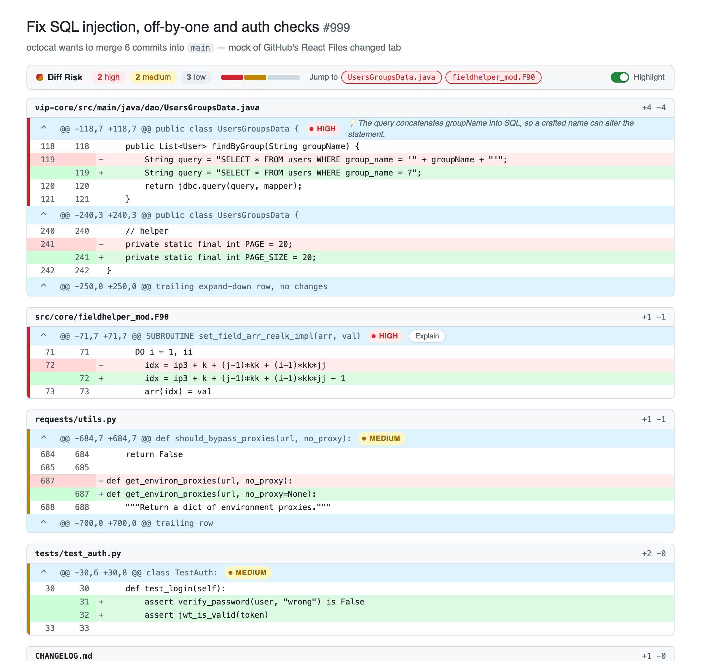
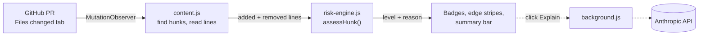
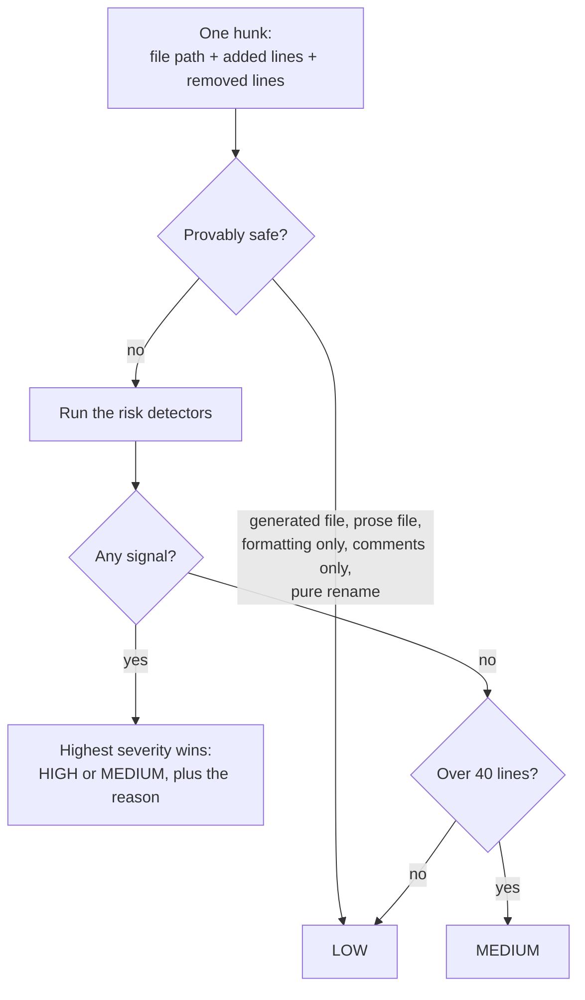

# Diff Risk Highlighter

A Chrome extension that reads a GitHub pull request's **Files changed** tab and tells you which hunks deserve careful review and which are safe to skim. It uses plain static heuristics, so it runs instantly, offline, and with no API key.

<picture>
  <source media="(prefers-color-scheme: dark)" srcset="docs/img/screenshot-dark.png">
  
</picture>

<sub>Rendered by headless Chrome from [a fixture page](test/dom/pull/999/changes/new-ui-fixture.html) that copies GitHub's current diff markup, running the real `content.js`. Follows GitHub's light/dark theme.</sub>

## What it does

- **Flags risky hunks** with a colored edge and a `HIGH` / `MEDIUM` badge. Hover a badge to see *why*.
- **Leaves safe hunks alone.** Reformatting, renames, comments, docs, and lockfiles are scored low and left untouched.
- **Summarizes the PR** in a sticky bar: counts, a proportional risk meter, and one-click jumps to every high-risk hunk.
- **Optional "Explain" button** on high-risk hunks asks Claude for a one-sentence explanation. Nothing leaves your browser unless you click it.

## How it works



`risk-engine.js` knows nothing about the DOM. It takes one hunk and returns `{ level, reason }`, which is why it is unit-testable in plain Node. `content.js` handles everything GitHub-specific.

### The risk engine



Safe-transform checks run **first**, so renaming a variable called `password` is still low risk.

| Signal | Level | Example it was built from |
|---|---|---|
| SQL built by string concatenation | High | VIP-portal#698, a real SQL-injection fix |
| Off-by-one shape: operator swap (`..` to `..=`), literal shifted by 1, or a `± 1` term added or removed | High | alacritty#9027, mglet-base#226 |
| `try`/`catch`/`except` count decreased | High | django#18925 |
| Security keywords (`password`, `jwt`, `csrf`, `authorization`, ...) in source code | High | partage#8, passkey-kit#4 |
| Same keywords inside a **test** file | Medium | check no assertion was weakened |
| Locking or atomicity primitives (`select_for_update`, `mutex`, `atomic`, ...) | High | race-condition fixes |
| Retry/backoff newly added | Medium | squarelet#777 |
| Conditional branch removed (High if it also drops a `return`/`raise`, or 3+ branches) | Medium | django#18925, pandas#66045, numpy#32143 |
| Function signature changed | Medium | requests#4052 |
| Large hunk with no other signal | Medium | fallback |

## Install

No build step and no dependencies.

1. Open `chrome://extensions` and turn on **Developer mode**.
2. Click **Load unpacked** and choose this folder.
3. Open any pull request's **Files changed** tab.

The toolbar icon toggles highlighting on and off (an `OFF` badge shows when it's disabled). The first time you click **Explain**, it asks for an Anthropic API key, which is stored only in `chrome.storage.local` and sent only to `api.anthropic.com`.

## Develop

```bash
npm test          # 55 unit + real-PR tests (Node's built-in runner, no install needed)
npm run icons     # regenerate icons/ (dependency-free PNG encoder)
python3 -m http.server 8934
```

With the server running, open these pages. Each runs the **real** `src/` files and prints PASS or FAIL:

| Page | Checks |
|---|---|
| `/test/dom/pull/999/changes/new-ui-fixture.html` | 22 checks against GitHub's current React markup: classification, summary bar, Explain, toggle, remount and tab-switch recovery, no self-triggering loop. Add `?theme=dark` for dark mode. |
| `/test/dom/pull/999/files/self-trigger-regression.html` | Classic (pre-React) markup, plus the mutation-observer loop guard |
| `/test/perf/synthetic-large-diff.html` | 150 files / 450 hunks scan timing |

## How well do the heuristics work?

They were calibrated and regression-tested on **17 real merged PRs** from open-source repos (no toy examples), listed in [test/fixtures/real-prs](test/fixtures/real-prs/README.md). Reading the output hunk by hunk, like a reviewer, found real gaps. All three are fixed and locked in with tests:

| Real PR | What was wrong | Now |
|---|---|---|
| mglet-base#226 (off-by-one fix by *adding* `- 1`) | 0 of 3 hunks flagged | 3 of 3 high |
| passkey-kit#4 (auth bypass fix) | 15 high, mostly CHANGELOG prose and version bumps | 3 high (the real fix), 5 medium (tests) |
| squarelet#777 (race-condition fix) | Nothing flagged for the race | 4 retry flags |

Reviewing also caught a bug that was invisible until real code was tried: `\bpassword\b` never matched `verify_password` or `checkPassword`, so most real identifiers slipped past the security detector.

## Limitations

- **Heuristics, not parsing.** Regex and text matching can be fooled by a keyword in a string or comment. Swapping in a real AST (e.g. tree-sitter) is the natural v2.
- **Narrow keyword lists on purpose.** Broader ones (`admin`, `token`, `auth*`) produced absurd false positives on real PRs. The cost is missing variants like `pwd`.
- **Concurrency is only partly covered.** Locks and retries are caught. Subtler races (check-then-act with no lock) are not.
- **GitHub changes its DOM.** It did mid-project: `/files` became `/changes` with a React rewrite. Both layouts are supported and the selectors are documented in [docs/github-diff-dom.md](docs/github-diff-dom.md), but expect to re-check them occasionally.
- **Verification gaps.** Loading an unpacked extension needs a native file picker, so the shipped files were verified by running them on fixture pages and by injecting them into live GitHub PRs, not by an automated "Load unpacked". "Explain" was tested with a mocked reply, not a live API call. Very large PRs on the new UI (lazy-loaded diffs) were not re-tested.
- github.com only (no Enterprise domains). The sticky bar can overlap GitHub's own sticky headers slightly while scrolling.

## Project layout

```
manifest.json            Manifest V3 config
src/risk-engine.js       The heuristics: pure, DOM-free, unit-tested
src/content.js           Finds hunks (classic + React DOM), draws badges and the summary bar
src/background.js        Optional Anthropic call (CSP-safe) + toolbar toggle
icons/                   Generated by scripts/make-icons.js
docs/                    github-diff-dom.md (selector notes), img/ (screenshots)
test/                    Unit tests, 17 real-PR fixtures, DOM fixture pages, perf harness
```
