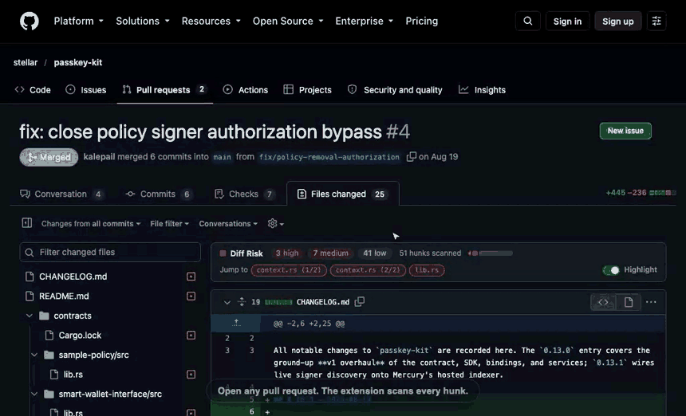
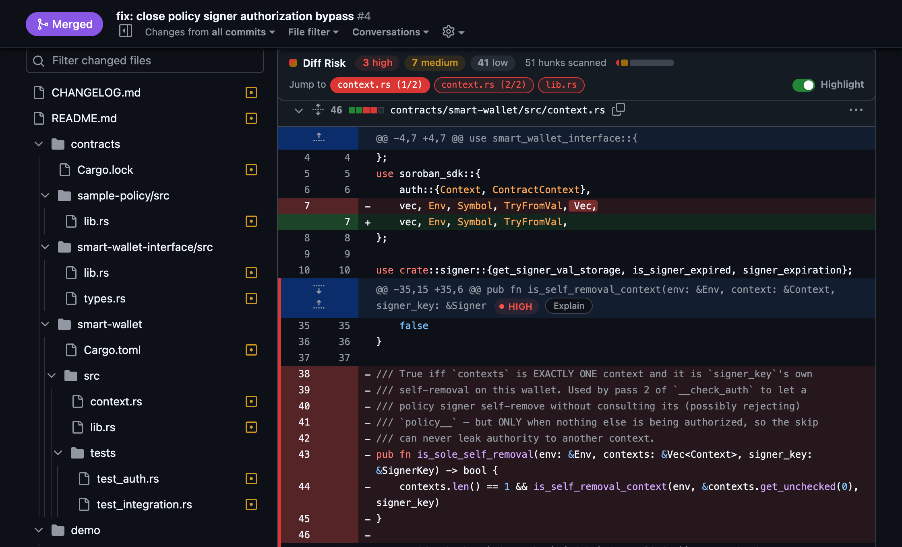
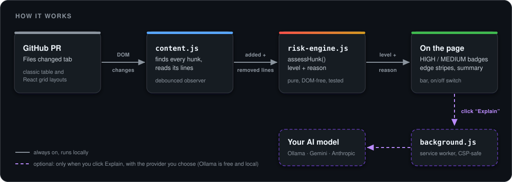
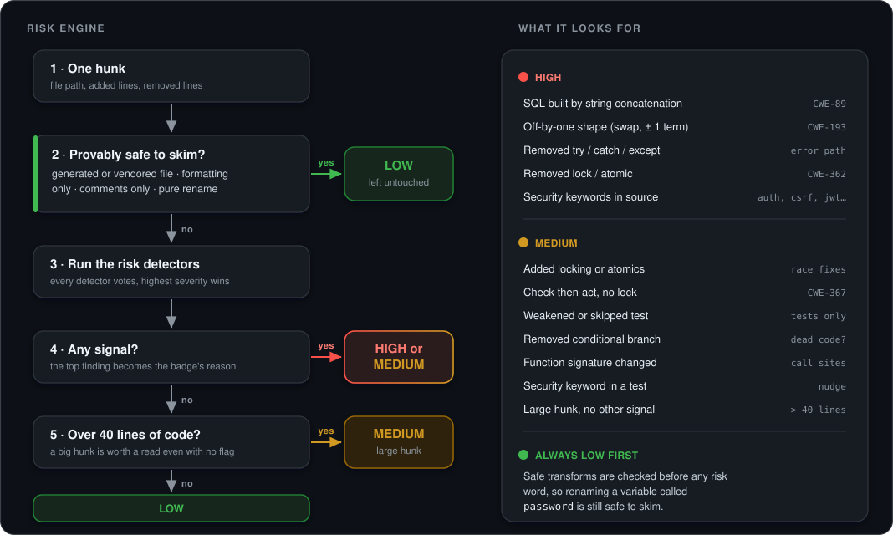
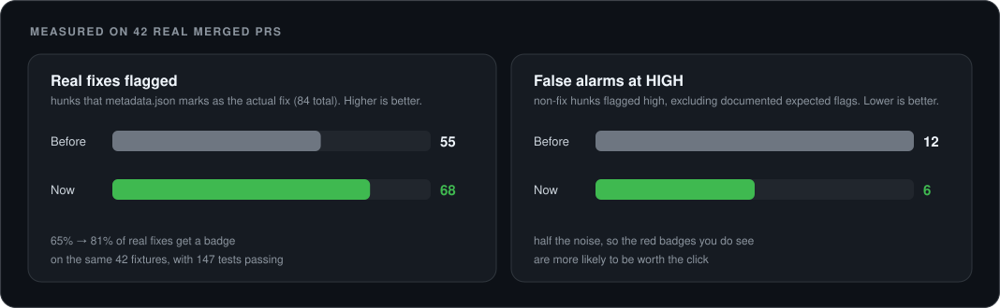

<div align="center">

# Diff Risk Highlighter

**Know which hunks of a pull request deserve your attention, and which are safe to skim.**

A Chrome extension that reads GitHub's **Files changed** tab and flags risky hunks with plain static heuristics. It runs instantly, offline, with no API key.

[](https://github.com/Vrinda072/diff-risk-highlighter/actions/workflows/test.yml)


<br>



<sub>The real extension, loaded unpacked in Chromium, on a live pull request ([stellar/passkey-kit#4](https://github.com/stellar/passkey-kit/pull/4), an authorization-bypass fix) in GitHub's dark theme. Cursor and captions are added by [the recording script](scripts/record-demo.js). <a href="docs/img/demo.webm">Higher-quality WebM</a>.</sub>

</div>

<br>

## Contents

[Why](#why) · [What you see](#what-you-see) · [How it works](#how-it-works) · [The risk engine](#the-risk-engine) · [Does it work?](#does-it-work) · [Install](#install) · [Develop](#develop) · [Known Limitations / Future Work](#known-limitations--future-work) · [References](#references) · [Layout](#project-layout)

## Why

Code review is a large, ongoing investment of developer time [[1]](#references) [[2]](#references), and a pull request often mixes the hunks that change behavior with renames, reformatting, generated files and docs. Predicting which *changes* are risky is an established research direction, usually with learned models [[3]](#references). This project takes a deliberately simple route instead: about a dozen transparent heuristics, each tied to real fixes in real pull requests, so a reviewer can read *why* a hunk was flagged and disagree with it.

## What you see

<div align="center">

</div>

- **A colored edge and a `HIGH` / `MEDIUM` badge** on every flagged hunk. Hover a badge for the reason.
- **Safe hunks are left alone.** Reformatting, renames, comments, docs, generated and vendored files score low and get no marking at all.
- **A sticky summary bar** with counts, a proportional risk meter and one-click jumps to each high-risk hunk (two high hunks in one file read `context.rs (1/2)` and `(2/2)`).
- **A switch** (and the toolbar icon) to turn highlighting off and on.
- **An optional "Explain" button** on high-risk hunks asks Claude for a one-sentence reason. Nothing leaves your browser unless you click it.

It follows GitHub's theme (light, dark, high-contrast) because every color comes from GitHub's own Primer CSS variables [[11]](#references). The screenshot above is a live pull request: 3 high, 7 medium and 41 low out of 51 hunks.

## How it works

<div align="center">

</div>

`risk-engine.js` knows nothing about the DOM: it takes one hunk and returns `{ level, reason }`, which is why it is unit-testable in plain Node. `content.js` does everything GitHub-specific, for both GitHub's classic diff markup and its newer React layout (`/changes`), and re-scans with a debounced `MutationObserver` [[12]](#references) as GitHub lazy-loads files. The optional Explain call is made from a background service worker, because a content script's `fetch` is subject to GitHub's page CSP [[13]](#references).

## The risk engine

<div align="center">

</div>

Safe-transform checks run **first**, so renaming a variable called `password` is still low risk. The detectors cover weakness classes that real fixes in the calibration set exercise: SQL built by concatenation (CWE-89 [[5]](#references)), off-by-one bounds (CWE-193 [[6]](#references)), removed locks and added synchronization (CWE-362 [[7]](#references)), unlocked check-then-act (CWE-367 [[8]](#references)), and missing or bypassed authorization and CSRF checks (CWE-862, CWE-639, CWE-352 [[9]](#references)).

A few design rules that came from reading real output rather than from theory:

- **Narrow keyword lists.** `admin`, `token` and `auth*` flagged every hunk of `django.contrib.admin`. Keywords now match as whole words *inside* identifiers (`verify_password`, `checkPassword`) but not as fragments (`secretary`).
- **Prose never raises a security flag.** A CHANGELOG line that *describes* an authorization fix isn't one. Version bumps like `"0.16.2"` to `"0.16.3"` are ignored by the off-by-one detector.
- **Formatting-only includes quote style**, unless the line interpolates (`"$x"` and `'$x'` differ in shell).
- **Similarity** between an old and new line, used to spot a one-token edit, is the Sørensen–Dice coefficient over character bigrams [[4]](#references), not a full diff.
- **Path rules** for generated, vendored and documentation files are adapted from GitHub's own [linguist](https://github.com/github-linguist/linguist) [[10]](#references).

## Does it work?

<div align="center">

</div>

The engine is calibrated and regression-tested on **42 real merged pull requests** from open-source repositories, across nine categories (auth and security, off-by-one, race condition, weakened test, refactor, dead-code removal, signature change, dependency bump, feature). [`metadata.json`](test/fixtures/real-prs/metadata.json) records which hunk is the actual fix in each, which makes recall measurable, and [`test/fix-recall.test.js`](test/fix-recall.test.js) ratchets it so it cannot silently regress. The fixture list and the story behind each PR are in [test/fixtures/real-prs](test/fixtures/real-prs/README.md).

What moved the numbers, each found by reading real output hunk by hunk:

| Change | Evidence |
|---|---|
| Match keywords inside `snake_case` / `camelCase` identifiers (`\b` treats `_` as a word character, so `verify_password` never matched) | missing-authorization fix: 0 of 2 hunks flagged to 2 of 2 |
| Adding a lock is a medium flag (most race fixes *add* synchronization) | race fixtures `spp` 0 of 2 to 2 of 2, `pdns` 6 of 11 to 10 of 11 |
| A security word inside a **test** file is medium, not high | passkey-kit#4 false alarms at high: 5 to 0, its 3 real fix hunks stay high |
| Quote-only changes (`"x"` to `'x'`) count as formatting, unless the line interpolates | unit-tested, including the shell `"$x"` counterexample. A hunk that *also* drops redundant parentheses is not provably formatting-only, so a Prettier PR can still get a few flags (passcore_prettier went from 2 to 3 high) |

The unit and real-PR suites run in CI. The end-to-end suite loads this folder as a real unpacked extension in Chromium and checks the badges and summary counts against the engine on live GitHub pages (68 of 68 passing on the classic layout).

## Install

No build step, no runtime dependencies.

1. Open `chrome://extensions` and turn on **Developer mode**.
2. Click **Load unpacked** and choose this folder (the one containing `manifest.json`).
3. Open any pull request's **Files changed** tab.

The toolbar icon toggles highlighting (an `OFF` badge shows when it's disabled). The first time you click **Explain**, it asks for an Anthropic API key [[14]](#references), stored only in `chrome.storage.local` and sent only to `api.anthropic.com`. Everything else works without one.

## Develop

```bash
npm test                      # unit, real-PR and fixture-metadata tests (Node's built-in runner, no install)
npm run icons                 # regenerate icons/ (dependency-free PNG encoder)
python3 -m http.server 8934   # then open the fixture pages below
```

| Page (served by the command above) | Checks |
|---|---|
| `/test/dom/pull/999/changes/new-ui-fixture.html` | 23 checks against GitHub's React markup: classification, summary bar, Explain, toggle, remount and tab-switch recovery, no self-triggering loop. Add `?theme=dark`. |
| `/test/dom/pull/999/files/self-trigger-regression.html` | Classic markup, plus the observer-loop guard |
| `/test/perf/synthetic-large-diff.html` | 150 files, 450 hunks, scan timing |

**End-to-end (Playwright [[16]](#references)):** loads this folder as an unpacked extension and runs it on the live "Files changed" page of every PR behind the fixtures. It needs network access, so it is separate from `npm test`.

```bash
npm install && npx playwright install chromium
npm run test:e2e
```

Signed out, GitHub serves the classic UI; the React UI is only served to signed-in sessions. To run against it, sign in once in the window this opens (you type your own credentials; cookies are saved to the gitignored `e2e/.auth/`): `npm run test:e2e:login`.

**Re-record the demo** (live network, Playwright's bundled ffmpeg, and `pip install pillow`):

```bash
node scripts/record-demo.js && python3 scripts/make-gif.py 860 6
```

## Known Limitations / Future Work

- **Heuristics, not parsing.** Regex and text matching can be fooled by a keyword in a string or comment. Swapping in a real syntax tree (e.g. tree-sitter [[17]](#references)) is the natural v2.
- **16 of 84 real-fix hunks are still missed.** Examples: a lookup moved *inside* an existing lock (nats-server#8647), a CSRF cookie-prefix rename, and some thread-pool races in C. Check-then-act is only caught in code that visibly runs concurrently.
- **Narrow keyword lists on purpose.** Broader ones produced absurd false positives on real PRs; the cost is missing variants like `pwd`.
- **Added locking is a nudge, not proof of a fix.** It fires on any hunk that adds a lock, including ordinary new concurrent code.
- **GitHub changes its DOM.** It did mid-project: `/files` became `/changes` with a React rewrite. Both are supported, with selectors documented in [docs/github-diff-dom.md](docs/github-diff-dom.md), but expect to re-check them occasionally.
- **Not yet verified:** the e2e suite against the React UI (signed out, GitHub serves the classic UI, which is what has run), so lazy-loading on very large PRs there is untested. And "Explain" has only been tested with a mocked reply, not the live API.
- github.com only (no Enterprise domains). The sticky bar can overlap GitHub's own sticky headers slightly while scrolling.

## References

**Why review attention matters, and risk at the change level**

1. A. Bacchelli and C. Bird. *Expectations, Outcomes, and Challenges of Modern Code Review.* ICSE 2013. [doi:10.1109/ICSE.2013.6606617](https://doi.org/10.1109/ICSE.2013.6606617)
2. C. Sadowski, E. Söderberg, L. Church, M. Sipko and A. Bacchelli. *Modern Code Review: A Case Study at Google.* ICSE-SEIP 2018. [doi:10.1145/3183519.3183525](https://doi.org/10.1145/3183519.3183525)
3. Y. Kamei, E. Shihab, B. Adams, A. E. Hassan et al. *A Large-Scale Empirical Study of Just-in-Time Quality Assurance.* IEEE TSE 2013. [doi:10.1109/TSE.2012.70](https://doi.org/10.1109/TSE.2012.70)
4. L. R. Dice. *Measures of the Amount of Ecologic Association Between Species.* Ecology 26(3), 1945. [doi:10.2307/1932409](https://doi.org/10.2307/1932409) (the bigram similarity used to pair edited lines)

**Weakness classes the detectors target**

5. [CWE-89](https://cwe.mitre.org/data/definitions/89.html) SQL injection · see also [OWASP Top 10](https://owasp.org/Top10/)
6. [CWE-193](https://cwe.mitre.org/data/definitions/193.html) Off-by-one error
7. [CWE-362](https://cwe.mitre.org/data/definitions/362.html) Race condition
8. [CWE-367](https://cwe.mitre.org/data/definitions/367.html) Time-of-check time-of-use
9. [CWE-862](https://cwe.mitre.org/data/definitions/862.html) Missing authorization · [CWE-639](https://cwe.mitre.org/data/definitions/639.html) Authorization bypass via user-controlled key (IDOR) · [CWE-352](https://cwe.mitre.org/data/definitions/352.html) Cross-site request forgery

**Platform, tools and data**

10. [github-linguist/linguist](https://github.com/github-linguist/linguist): GitHub's own generated, vendored and documentation path rules, which the engine's file classification is adapted from.
11. [Primer](https://primer.style): GitHub's design system, whose CSS variables the extension's colors use.
12. MDN: [MutationObserver](https://developer.mozilla.org/en-US/docs/Web/API/MutationObserver).
13. Chrome for Developers: [extensions](https://developer.chrome.com/docs/extensions/develop), [content scripts](https://developer.chrome.com/docs/extensions/develop/concepts/content-scripts) and the [action API](https://developer.chrome.com/docs/extensions/reference/api/action) (toolbar toggle).
14. Anthropic: [Messages API](https://docs.anthropic.com/en/api/messages) (the optional Explain call).
15. Node.js: [test runner](https://nodejs.org/api/test.html) (what `npm test` uses).
16. Playwright: [testing Chrome extensions](https://playwright.dev/docs/chrome-extensions) (the e2e suite and the demo recording).
17. [tree-sitter](https://tree-sitter.github.io/tree-sitter/): the parser library a v2 could build on. GNU diffutils: [unified diff format](https://www.gnu.org/software/diffutils/manual/html_node/Unified-Format.html), which the test fixtures use.
18. The 42 real pull requests behind the calibration set, with source links and what each one tests: [test/fixtures/real-prs/README.md](test/fixtures/real-prs/README.md).

## Project layout

```
manifest.json            Manifest V3 config
src/risk-engine.js       The heuristics: pure, DOM-free, unit-tested
src/content.js           Finds hunks (classic + React DOM), draws badges and the summary bar
src/background.js        Optional Anthropic call (CSP-safe) + toolbar toggle
icons/                   Generated by scripts/make-icons.js
docs/img/                Demo recording, live screenshot, diagrams
docs/github-diff-dom.md  Selector notes for GitHub's two diff layouts
test/                    Unit tests, 42 real-PR fixtures + metadata, DOM fixture pages, perf harness
e2e/                     Playwright: the real extension on live GitHub PRs
scripts/                 record-demo.js, make-gif.py, make-icons.js, fetch-fixtures.js
```
